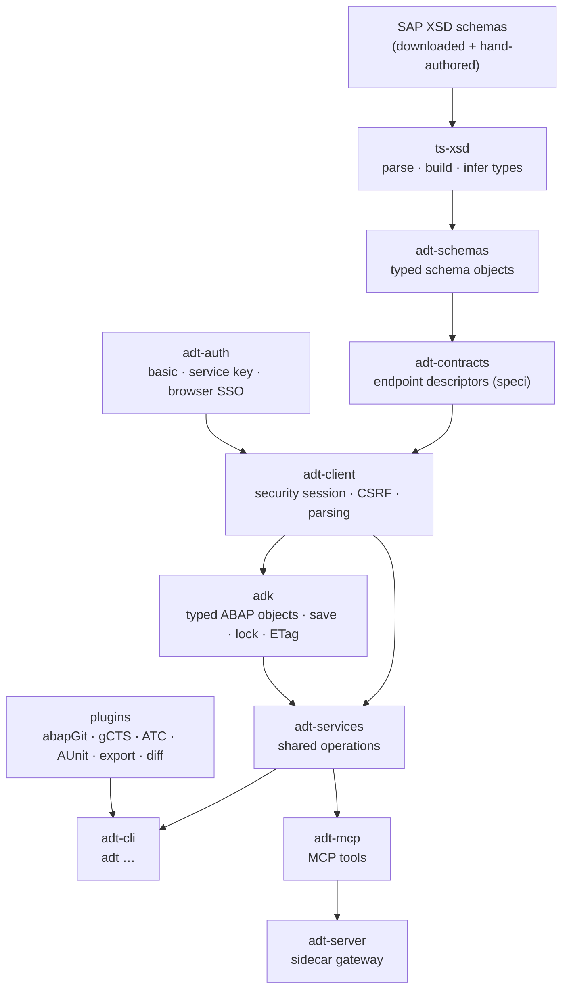

# abapify

**Open, typed tooling for SAP ABAP Development Tools (ADT) — for the terminal, for CI, and for AI agents.**

[](https://github.com/abapify/adt-cli/actions/workflows/ci.yml)
[](https://www.npmjs.com/package/@abapify/adt-cli)
[](https://adt-cli.netlify.app)
[](./LICENSE)

> **Using abapify?** Head to the user documentation at **[adt-cli.netlify.app](https://adt-cli.netlify.app)** — installation, authentication, guides, and the full CLI / MCP / SDK reference.
>
> This README is about the **project**: what it is, why it exists, and how it is built.

## What it is

abapify is a TypeScript monorepo that speaks the same HTTP protocol Eclipse ADT uses to talk to an ABAP system, and turns it into four things you can actually build on:

| Surface            | Package                                                                                               | For                                                                |
| ------------------ | ----------------------------------------------------------------------------------------------------- | ------------------------------------------------------------------ |
| **`adt` CLI**      | [`@abapify/adt-cli`](./packages/adt-cli) (or the single-file bundle [`@abapify/adt`](./packages/adt)) | Developers in a terminal, scripts, CI pipelines                    |
| **MCP server**     | [`@abapify/adt-mcp`](./packages/adt-mcp)                                                              | AI assistants and agents (Claude, Copilot, Cursor, Windsurf, …)    |
| **ADT sidecar**    | [`@abapify/adt-server`](./packages/adt-server)                                                        | Shared deployments that must keep SAP credentials away from agents |
| **TypeScript SDK** | [`@abapify/adt-client`](./packages/adt-client), [`@abapify/adk`](./packages/adk), …                   | Tool builders who want typed access to ADT from their own code     |

All four sit on the same typed contract stack, so a fix in one place reaches every surface.

## Why it exists

ADT is the most complete remote API an ABAP system has — it is what powers Eclipse-based ABAP development. But it is an XML-over-HTTP protocol with a security-session handshake, CSRF tokens, lock handles and ETags, and almost no public documentation. Outside Eclipse there was no first-class, scriptable way to use it.

That gap matters more every year:

- **ABAP teams want modern workflows** — git, code review, pull requests, CI quality gates — without leaving their system of record.
- **CI/CD needs headless access** — run ATC and ABAP Unit, publish SARIF / JUnit / coverage, move transports, all from a pipeline.
- **AI agents need safe, structured tools** — not screen-scraping or raw HTTP, but typed operations with the locking and activation rules SAP expects.

abapify closes that gap in the JavaScript ecosystem: `npm i` and go, no SAP GUI, no Eclipse, no system-side installation.

## How it works



The design rests on a few deliberate choices:

1. **Contract-first, schema-driven.** Every XML endpoint has an XSD → typed schema → `speci` contract chain. Request and response types are inferred end-to-end; there is no hand-written XML parsing in application code. Fix a schema once and the CLI, MCP tools and SDK all pick it up.
2. **One service layer, two front ends.** CLI commands and MCP tools call the same transport-agnostic operations in `adt-services`, so the two surfaces stay at parity instead of drifting apart.
3. **Writes go through the ADK.** Lock → write → activate → unlock, ETag refresh and batch lock sessions live in one place (`adk` + `adt-locks`), so callers cannot get the SAP protocol subtly wrong.
4. **Plugins instead of a monolith.** Serialization formats (abapGit, gCTS) and command groups (ATC, AUnit, export, diff, gCTS) are plugins behind small interfaces in `adt-plugin`; core packages never import a concrete plugin.
5. **Credentials stay at the edge.** Authentication is pluggable (`adt-auth` + browser adapters). For shared and agent deployments, `adt-server` holds destinations and credentials and exposes only scoped MCP / REST access.
6. **Tested without SAP, verified against SAP.** An in-process mock ADT server backed by real recorded responses drives unit and e2e tests; a separate opt-in suite runs against a real system.

The deep dives live in [`docs/architecture/`](./docs/architecture/overview.md).

## A quick taste

```bash
npm i -g @abapify/adt-cli
adt auth login                     # interactive: basic, service key, or browser SSO
adt search "ZCL_*"                 # find objects
adt source get ZCL_MY_CLASS        # read source to stdout
adt checkout package ZMY_PKG ./src # abapGit-compatible files on disk
adt checkin ./src                  # push local changes back to SAP
```

Hooking an AI assistant up is one entry in its MCP config (`npx @abapify/adt-mcp`). Everything else — commands, MCP tools, SDK usage, CI recipes — is in the **[user documentation](https://adt-cli.netlify.app)**.

## Project map

All packages live in [`packages/`](./packages) and are published to npm under [`@abapify/*`](https://www.npmjs.com/search?q=%40abapify) (except `adt-fixtures`, which is test-only).

| Layer                       | Packages                                                                                                                                                                                                                                                                                                |
| --------------------------- | ------------------------------------------------------------------------------------------------------------------------------------------------------------------------------------------------------------------------------------------------------------------------------------------------------- |
| **Applications**            | [`adt-cli`](./packages/adt-cli) · [`adt`](./packages/adt) · [`adt-mcp`](./packages/adt-mcp) · [`adt-server`](./packages/adt-server) · [`adt-server-client`](./packages/adt-server-client) · [`adt-pilot`](./packages/adt-pilot) · [`adt-proxy`](./packages/adt-proxy) · [`adt-tui`](./packages/adt-tui) |
| **CLI plugins**             | [`adt-atc`](./packages/adt-atc) · [`adt-aunit`](./packages/adt-aunit) · [`adt-diff`](./packages/adt-diff) · [`adt-export`](./packages/adt-export) · [`adt-flow`](./packages/adt-flow) · [`adt-plugin-gcts-cli`](./packages/adt-plugin-gcts-cli)                                                         |
| **Format plugins**          | [`adt-plugin`](./packages/adt-plugin) · [`adt-plugin-abapgit`](./packages/adt-plugin-abapgit) · [`adt-plugin-gcts`](./packages/adt-plugin-gcts)                                                                                                                                                         |
| **Object model & services** | [`adk`](./packages/adk) · [`adt-services`](./packages/adt-services) · [`adt-locks`](./packages/adt-locks) · [`adt-lint`](./packages/adt-lint) · [`adt-codegen`](./packages/adt-codegen)                                                                                                                 |
| **Protocol**                | [`adt-client`](./packages/adt-client) · [`adt-contracts`](./packages/adt-contracts) · [`adt-schemas`](./packages/adt-schemas) · [`adt-rfc`](./packages/adt-rfc) · [`speci`](./packages/speci) · [`ts-xsd`](./packages/ts-xsd)                                                                           |
| **Auth & config**           | [`adt-auth`](./packages/adt-auth) · [`browser-auth`](./packages/browser-auth) · [`adt-playwright`](./packages/adt-playwright) · [`adt-puppeteer`](./packages/adt-puppeteer) · [`adt-config`](./packages/adt-config)                                                                                     |
| **ABAP language tooling**   | [`aclass`](./packages/aclass) · [`acds`](./packages/acds) · [`abap-ast`](./packages/abap-ast) · [`asjson-parser`](./packages/asjson-parser) · [`openai-codegen`](./packages/openai-codegen)                                                                                                             |
| **Shared & test**           | [`logger`](./packages/logger) · [`adt-fixtures`](./packages/adt-fixtures) _(private)_                                                                                                                                                                                                                   |

Every package has its own README (what you see on npm) and a reference page on the [docs site](https://adt-cli.netlify.app/sdk/packages/overview).

## Status

abapify is **pre-1.0** and moving fast: all packages are released together from `main` with a single version. The CLI and MCP server cover the day-to-day ADT surface — repository search and navigation, source read/write, DDIC, CDS, RAP (BDEF / SRVD / SRVB), function modules, BAdIs, transports, ATC, ABAP Unit with coverage, abapGit and gCTS round-trips, RFC, STRUST and Fiori Launchpad inventory. Expect breaking changes between minor versions until 1.0.

- What shipped and why: [`docs/roadmap/shipped.md`](./docs/roadmap/shipped.md)
- Open questions and next steps: [`docs/roadmap/future.md`](./docs/roadmap/future.md)
- Changes: [`CHANGELOG.md`](./CHANGELOG.md)

## Documentation map

| Where                                                              | Audience    | What                                                         |
| ------------------------------------------------------------------ | ----------- | ------------------------------------------------------------ |
| [adt-cli.netlify.app](https://adt-cli.netlify.app)                 | Users       | Getting started, guides, CLI / MCP / SDK reference           |
| Package READMEs ([npm](https://www.npmjs.com/search?q=%40abapify)) | Users       | What each package does, install, a minimal example           |
| [`docs/`](./docs)                                                  | Maintainers | Architecture deep dives, roadmap, deployment, design history |
| [`openspec/`](./openspec)                                          | Maintainers | Behaviour specs and in-flight change proposals               |
| [`AGENTS.md`](./AGENTS.md) and [`.agents/`](./.agents)             | AI agents   | Repository rules, skills, and workflows for coding agents    |

## Contributing

Contributions are welcome — bug reports, endpoint coverage, plugins, docs. Start with [`CONTRIBUTING.md`](./CONTRIBUTING.md) for the development setup, conventions and release process. Security issues: see [`SECURITY.md`](./SECURITY.md).

## License

[MIT](./LICENSE)
